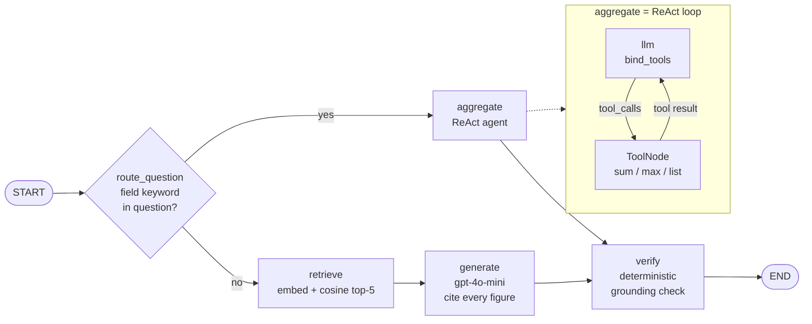

# financial-rag-agent

A question-answering system over monthly brokerage statements (CDSL consolidated
account statements: equity holdings, ETFs, mutual-fund folios, transactions),
built from scratch to learn the real mechanics of RAG and agents: row-aware
chunking, hand-written cosine retrieval, a LangGraph router, a ReAct
tool-calling agent for arithmetic questions, a deterministic grounding check,
and a route-aware evaluation harness.

> **Data notice.** The system was developed and measured on the author's private
> statements. Those are **not** in this repo. It ships a **synthetic** dataset
> instead — fictional holder, broker, funds, companies, ISINs and figures —
> generated in exactly the format the parser produces, so the whole pipeline
> runs end to end. See [Synthetic data](#synthetic-data).

## Architecture



| Stage | File | What it does |
|---|---|---|
| Parse | `scripts/parser.js` | PDF → page JSON with section labels (`summary`, `holdings`, `transactions`, `mf_units`), PII redaction |
| Synthesize | `scripts/make_synthetic.py` | Generates fictional statements in the parser's output format (used instead of real PDFs) |
| Chunk | `scripts/chunk.py` | Row-aware state machines: one chunk = one table row, every number labelled (`\|NAV: … \|Value: …`) |
| Embed | `scripts/embed.py` | `text-embedding-3-small`, batched, resumable |
| Answer | `scripts/lang.py` | The LangGraph app: router → aggregate (ReAct) or retrieve → generate → verify |
| Evaluate | `scripts/score.py` | Route-aware metrics (below) |
| Trace | `scripts/trace_agent.py` | Logs every model request/response and tool call of one agent run |

**Two paths, on purpose.**

- **Retrieve → generate → verify** for questions that need a fact. The prompt
  forces context-only answers, exact figures, a chunk_id citation after every
  figure, visible arithmetic, and a fixed refusal string (so refusals are
  countable).
- **Aggregate** for questions that need arithmetic over *all* matching rows
  (totals, maximums, lists). Top-k similarity can silently miss the 6th row of a
  sum, so this path filters the whole corpus by metadata instead. A ReAct agent
  (`bind_tools` + `ToolNode` + a conditional loop edge) chooses the verb —
  `sum_field_tool`, `max_field_tool` or `list_field_tool` — and deterministic
  code reads the numbers. The model never handles a figure it could change.
- **Verify** extracts every number in the answer and checks it against the
  context in code (not a second LLM): *grounded* (in context), *derived*
  (arithmetic on grounded values), or *ungrounded* (the real flag). It annotates
  and never blocks.

## Evaluation design

`eval/questions.md` holds 20 questions (summary, holdings, transactions,
mutual-fund sections) with backticked evidence tokens as ground truth;
`eval/questions2.md` holds 30 harder analytical questions, including ones that
are deliberately **not answerable** from the corpus (no rupee cash flows exist,
only unit quantities). Ground truth is computed by a script, not typed.

`score.py` routes each question exactly as the graph would and scores each path
on its own terms:

| Path | Metrics |
|---|---|
| retrieve | hit@1, hit@3, precision@k, recall@k, average precision → MAP |
| aggregate | exact-match accuracy (every name token + at least one figure in the answer) |

One blended number hid problems: aggregate questions never retrieve, so ranking
metrics on them are noise.

## Results (measured on the author's private statements)

| Metric | Result |
|---|---|
| Retrieval Top-1, 400-char windows → row-aware chunks | 25% → **35%** |
| Retrieval Top-3, same change | 40% → **70%** |
| Retrieve-path MAP (k = 5) | **0.530** |
| Aggregate-path exact match | **11/13 (85%)** |
| Answers with every figure grounded | **20/20** |

These numbers come from the original private corpus (116 chunks). The synthetic
dataset reproduces the same structure — **116 chunks: 12 mutual-fund, 62
holdings, 39 transaction, 3 summary** — but different text, so retrieval scores
will differ. Run `score.py` to get the numbers on the synthetic data.

## Lessons

- **Truncated context makes a model improvise.** Context was cut to 220
  characters; the model saw half a row and filled in the rest, confidently, with
  arithmetic that didn't even add up. Passing whole rows fixed it.
- **The model picks the verb; code picks the field.** The LLM is good at
  "is this a total, a maximum or a list?" and bad at naming the exact corpus
  label, so field, scheme and month come from deterministic extraction.
- **Grounding catches invention, not misuse.** Every figure in a wrong answer
  can be real and cited — summing balances with receipts — and still be wrong.
  Citations made that diagnosable in seconds; they don't prevent it.
- **Per-path metrics exposed a silent bug.** A `continue` inside an inner loop
  made the month filter a no-op, so July answers were three months summed: no
  exception, plausible number. Scoring the aggregate path on its own exposed it.
- **Row structure beats a smarter model.** The retrieval jump came from chunking
  that respects table rows, not from a better embedding model.

The longer write-ups: [docs/EVAL.md](docs/EVAL.md) (the chunking fix) and
[docs/AGENT.md](docs/AGENT.md) (router, generation, grounding, tool calling,
ReAct).

## Quickstart

Python 3.9+. Steps marked **(API)** call OpenAI and cost money (the full
embed + score run on 116 chunks is cents).

```bash
python3 -m venv .venv && source .venv/bin/activate
pip install -r requirements.txt
cp .env.example .env              # then put your key in OPENAI_API_KEY

python3 scripts/make_synthetic.py     # data_parsed/all_statements_clean.json (already committed)
python3 scripts/chunk.py              # chunks/character/chunks_character.json -> 116 chunks
python3 scripts/make_ground_truth.py  # eval/questions.md + questions2.md (already committed)
python3 scripts/embed.py              # (API) embeddings/character/embeddings_character.json

python3 scripts/lang.py "What was the total portfolio value in July 2025?"   # (API) one question
python3 scripts/lang.py               # (API) all Q01-Q20 + grounding summary
python3 scripts/score.py              # (API) route-aware metrics
python3 scripts/trace_agent.py "Which equity holding has the highest value?" # (API) eval/agent_trace.log
```

`scripts/fetch.py` is the original retrieval-only baseline harness (writes
top-5 per question to `eval/runs/`).

To use your own CDSL statements: put the PDFs in `data_raw/` (gitignored),
`npm install pdfjs-dist`, run `node scripts/parser.js`, set `HOLDER_NAME` in
`scripts/chunk.py`, and update the keyword dictionaries (`SCHEME_KEYWORDS`) in
`scripts/lang.py`. Note that the parser redacts the holder's name only in
known personal-name contexts; it still appears as a bare header line, which is
why the chunker skips it explicitly.

## Synthetic data

`scripts/make_synthetic.py` (fixed seed) renders three months (May–July 2025) of
statements page by page, reproducing what the chunkers depend on: ISIN-anchored
rows whose names wrap across lines, `--` placeholders as the holdings row
terminator, date-prefixed transaction lines, mixed transaction/holdings pages,
garbled bilingual chrome lines that the chunkers skip, redaction placeholders
(`[PAN]`, `[FOLIO]`, …), and one single-line holding the chunker is known to
drop. Figures are internally consistent: value = units × price, folio P/L =
valuation − invested, the summary's asset classes and percentages are sums of
the rows, and transaction balances carry month to month.

`scripts/privacy_scan.py` is the pre-publish check used to build this repo: it
scans every file against a denylist derived from the private statements
(figures, names, ISINs, ids). The denylist is local-only and gitignored.

## Layout

```
scripts/      pipeline (parser.js, make_synthetic, chunk, embed, lang, score, ...)
data_parsed/  synthetic statements (parser output format)
chunks/       row chunks (derived, committed for inspection)
eval/         questions.md, questions2.md (runs/ and traces are gitignored)
docs/         EVAL.md, AGENT.md
```

## License and author

MIT — see [LICENSE](LICENSE). Built by Yajur Bhatia.
